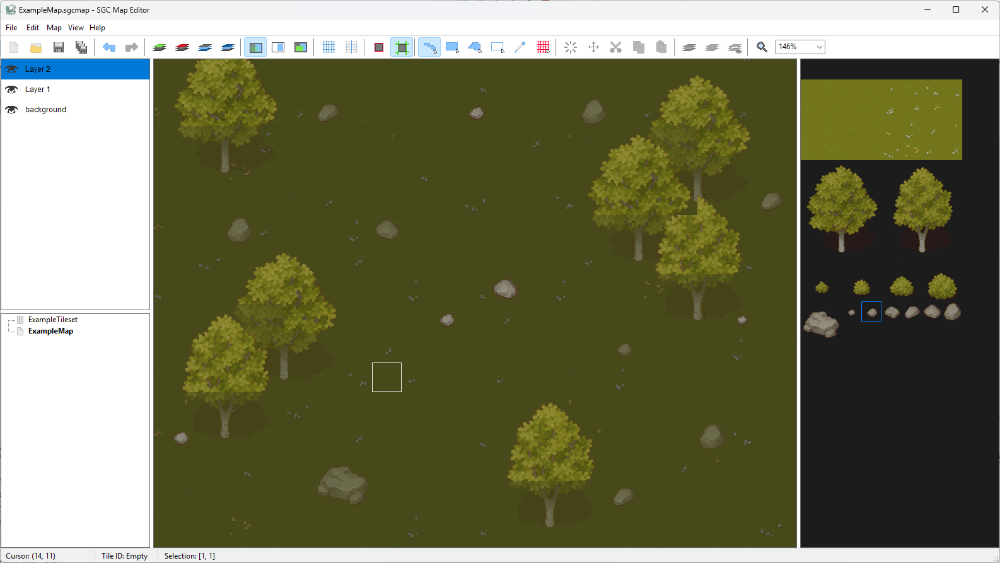

# Win32 Map Editor

## About

A 2D map editor for Windows developed in **C++23** using the **Win32 API** and **SDL3**.

The editor is designed for creating and editing tile-based maps. It uses my own SDL based rendering and game engine library called [sdl-game-core](https://github.com/kbz22/sdl-game-core). These are being developed in parallel.

The original design goal was to make something similar to the map editor in RPG Maker (my main influence would be RPG Maker XP) but less restricted. Most features at this point are however inspired by features in painting software but with the use of tiles. This is also my first project utilizing Win32 API which has been fun to learn but I regularly reconsider and refactor my earlier aproach as I learn things.



To make the example map in the screenshot I used free assets made by Cainos. Those are not bundled with any release of this software. They are available [here](https://cainos.itch.io/pixel-art-top-down-basic).

## Features
Right now there are still many features missing, incomplete or buggy but the core ability to create and edit maps is present. Currently the editor supports only my own binary file format but I consider adding an option to export to other formats.

* Drawing with tiles using basic tools: brush, rectangle and fill
* Map are stored and created in 32x32 tile chunks
* Support for multiple layers, with ability to name and toggle visibility of each layer
* Selection tools that allows to move, clear, copy and paste tiles
* Ability to zoom/out
* Ability to use mouse, pen and touch input and assign them seperately to panning and painting for touch displays
* Ability to open multiple tilesets and maps files or package files that can bundle the map and tileset documents together
* Support for custom shortcuts

# Building

## Requirements

* **CMake 3.20 or newer**
* A C++ compiler with **C++23** support
* **SDL3**
* **SDL3_image**
* **sdl-game-core**
* **nlohmann/json** — downloaded automatically by CMake using `FetchContent`
* Windows, as the editor uses the Win32 API

The project is currently configured for building with **MSVC** and uses the following compiler options:

* `/W4`
* `/permissive-`

## Dependencies

The paths to SDL3, SDL3_image, and `sdl-game-core` are provided to CMake through environment variables:

```text
SGC_INCLUDE_PATH
SGC_LIB_PATH
SDL_INCLUDE_PATH
SDL_LIB_PATH
SDL_IMAGE_LIB_PATH
```

For example, on Windows:

```powershell
$env:SGC_INCLUDE_PATH="C:\Libraries\sdl-game-core\include"
$env:SGC_LIB_PATH="C:\Libraries\sdl-game-core\lib"
$env:SDL_INCLUDE_PATH="C:\Libraries\SDL3\include"
$env:SDL_LIB_PATH="C:\Libraries\SDL3\lib"
$env:SDL_IMAGE_LIB_PATH="C:\Libraries\SDL3_image\lib"
```

The exact paths will depend on where the dependencies are installed.

## Configure and Build

Clone the repository and create a build directory:

```powershell
git clone <repository-url>
cd sgc-editor

cmake -S . -B build
cmake --build build --config Release
```

The executable will be generated in the configuration-specific build directory, for example:

```text
build/Release/sgc-editor.exe
```

### Visual Studio

CMake can also generate a Visual Studio solution:

```powershell
cmake -S . -B build -G "Visual Studio 18 2026"
```

The generated solution can then be opened in Visual Studio and built normally.

## Runtime DLLs

Any `.dll` files placed in the project's `dlls` directory are automatically copied next to the executable during the build.

This can be used to provide the required SDL3 and other runtime DLLs without manually copying them after every build.
